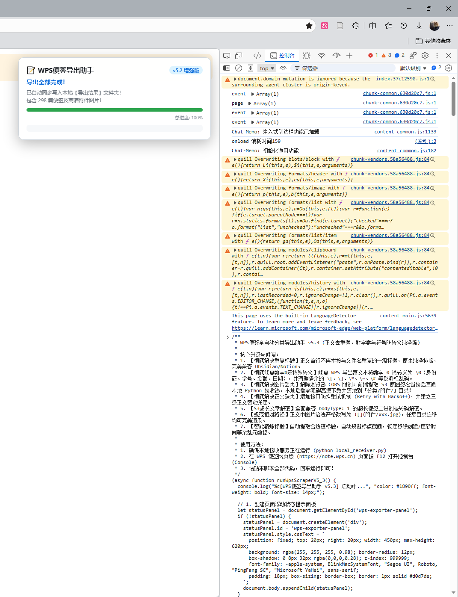

# WPS 便签按分类自动导出为 Markdown (.md) 工具

<p align="center">
  
  
  
  
</p>

> 🚀 **一键将 WPS 网页版便签完整导出为按分类整理的纯净 Markdown (`.md`) 文档，自动下载高清图片附件至本地并保持相对路径引用。零三方库依赖，开箱即用。**

<p align="center">
  
</p>

---

## 💻 前置要求

- **操作系统**：Windows 10 / 11、macOS（Linux 可手动执行 Python 脚本）
- **Python 环境**：已安装 Python 3.7 或更新版本（仅使用 Python 原生内置库，**无需执行任何 pip 安装**）
- **浏览器**：Edge、Chrome 或任何 Chromium 内核浏览器

---

## 🚀 极简操作步骤（推荐）

### 第一步：运行一键准备
- **Windows**：在当前文件夹中，双击运行 **`一键准备.bat`**。
- **macOS**：在当前文件夹中，双击运行 **`一键准备.command`**；也可以在终端进入项目目录后执行：

  ```bash
  bash ./一键准备.sh
  ```

  若双击提示没有执行权限，可在项目目录的终端执行 `chmod +x 一键准备.command 一键准备.sh` 后重试；若系统阻止打开，直接使用上面的 `bash` 命令。脚本会自动查找 `python3` 或符合版本要求的 `python`，缺少 Python 时会提示安装。

启动后：
1. **自动复制脚本**：脚本会将导出核心代码（`wps_scraper_snippet.js`）自动写入系统剪贴板（无需手动打开文件复制）。
2. **自动启动接收服务**：在当前终端窗口启动 Python 接收器（监听本地 `8765` 端口），并在项目文件夹下自动建立 **`导出结果`** 目录准备接收文件。
> ⚠️ **提示**：终端窗口在导出完成前**请勿关闭**；完成后可按 `Ctrl+C` 停止服务。

---

### 第二步：登录 WPS 便签网页版并打开控制台
1. 打开 Edge 或 Chrome 浏览器，访问并登录 [WPS 便签网页版 (note.wps.cn)](https://note.wps.cn)。
2. 在便签页面任意空白处，按下键盘快捷键 **`F12`**（或 **`Ctrl + Shift + I`**，或页面右键 -> 选择 **“检查”**）。macOS 上可按 **`Command + Option + J`** 直接打开控制台。
3. 在弹出的开发者工具顶部，点击切换到 **“控制台” (Console)** 标签页。

---

### 第三步：粘贴并回车运行
1. 在控制台最下方的光标处，直接按下 **`Ctrl + V`**（macOS 为 **`Command + V`**，粘贴第一步已复制的代码）。
2. 按下 **回车 (Enter)** 键运行。
3. 页面右上角会立即弹出蓝色进度面板，开始全自动抓取与分析。
4. 完成后核对面板的“已提取”和“本地确认保存”数量；若自动下载未出现，可点击面板底部的 **“点击下载 ZIP”** 链接。

> 更新脚本后，请先在旧接收器终端按 `Ctrl+C`，再运行“一键准备”，并重新把代码粘贴到网页控制台。仅再次粘贴旧剪贴板内容不会加载新版本。

### 没有导出文件时

- **请求地址包含 `user/undefined`**：说明使用了旧脚本。新版从登录信息读取用户 ID，并分页获取首页便签；重新运行“一键准备”并粘贴新代码。
- **显示“本地接收器不可用”**：确认终端服务仍在运行，按浏览器提示允许访问本地网络；也可以使用 ZIP 下载链接保存。
- **显示 0 篇或读取失败**：面板会保留错误日志，不再将空结果显示为成功；确认登录后页面能显示便签，再根据日志排查。
- **端口被旧版接收器占用**：关闭原终端中的服务后重启。新版连接探测不会清空既有导出，重复导出会保留同名文件并添加编号。

---

### 第四步：查看导出结果
抓取完成后，回到当前文件夹下的 **`导出结果`** 目录即可查看导出的笔记：

```text
当前文件夹/
├── 一键准备.bat
├── 一键准备.sh
├── 一键准备.command
├── local_receiver.py
├── unpack_backup.py
├── wps_scraper_snippet.js
├── README.md
└── 导出结果/                       <-- 导出的笔记全部保存在这里
    ├── 工作/                      <-- 分类文件夹
    │   ├── 2026年度规划.md
    │   └── 附件/                  <-- 该分类下的高清图片
    │       ├── image_1.jpg
    │       └── 架构图.png
    ├── 生活/
    │   └── 读书清单.md
    └── 未分类/
```

---

## ✨ 核心排版清洗与还原特性

1. **彻底解决首行重复一级标题**：
   - 彻底移除正文首行额外拼接的 `# 标题`，排版极简干净，完美适配 Obsidian / Typora / Notion 等笔记软件原生标题显示逻辑。
2. **彻底修复数字 0 及特殊符号误转义**：
   - 修复 WPS 导出时将数字 0 错误转义为 `\0` 的问题（身份证号、学号、出生日期、金额价格、门牌号等 100% 恢复正常）。
   - 自动清除 `\[`、`\]`、`\*`、`\~`、`\#` 等多余转义符，还原纯净标点与排版。
3. **图片附件全量下载与本地化**：
   - 自动嗅探便签中的所有图片，直连金山云 S3 签名接口抓取高清原图。
   - 在每个分类文件夹下自动创建名为 **`附件`** 的子文件夹集中存放图片。
4. **规范的相对路径引用**：
   - `.md` 文档中统一使用相对路径 `` 引用图片，未来无论将文件夹移动到何处，图片都能完美渲染。
5. **全文未截断获取**：
   - 调用 WPS 内部原生解密器与 S3 大文本获取逻辑，杜绝只有开头几行的摘要截断问题。
6. **智能精炼标题**：
   - 自动识别前 12~14 字关键语义作为标题，彻底过滤图片标签，不把正文长句当标题。
7. **保留便签创建日期**：
   - 每个 Markdown 文件第一行使用便签的原始创建时间，格式为 `【2022.5.3 created】`，空一行后接正文。
   - 本地直写与 ZIP 导出均支持，日期按本机时区显示；创建时间缺失或无效时标注 `【创建时间未知 created】`，不会用修改时间或导出时间代替。
   - 示例：

     ```markdown
     【2022.5.3 created】

     这里是便签正文。
     ```


---

## 🔒 隐私安全与免责声明

1. **绝对本地运行**：
   - 脚本所有抓取与解密逻辑均在您的个人浏览器控制台中执行；
   - 接收端运行在本地主机环回地址（`127.0.0.1:8765`），**数据全程仅在您的本机流转，绝不会向任何第三方云端或个人服务器上传任何便签内容、Cookies 或账号凭证**。
2. **免责声明**：
   - 本项目仅供个人进行便签数据备份与跨平台迁移（如迁移至 Obsidian、Notion、Logseq 等）学习交流使用；
   - 请妥善保管导出的便签数据，避免泄露个人隐私与机密信息。

---

## 📄 开源许可证

本项目基于 [MIT 许可证](LICENSE) 开源。
